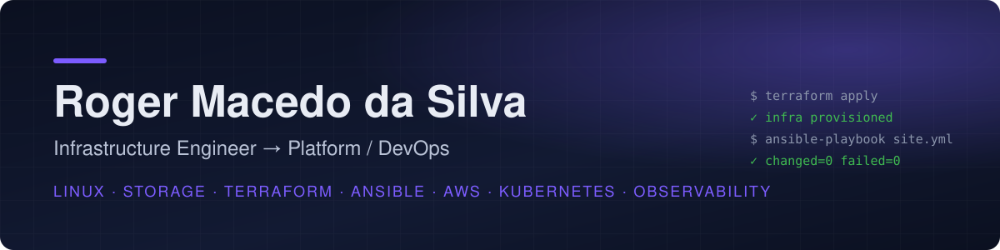

  

  
  
  

## 👋 Sobre mim

Engenheiro de infraestrutura com **mais de 20 anos** em storage, Linux, virtualização e redes, em transição para **engenharia de plataforma e DevOps**.
Passei **15 anos na Dell Technologies**, do suporte a clientes até especialista sênior em **ECS e PowerScale (Isilon)**, conduzindo incidentes de severidade 1 para uma base global.
Hoje aplico infraestrutura como código, CI/CD e observabilidade nos projetos abaixo.

> 🇺🇸 *Infrastructure engineer (20+ years: storage, Linux, virtualization, networking) moving into platform and DevOps engineering. 15 years at Dell Technologies, most recently as Senior Specialist for ECS and PowerScale. Open to fully remote roles.*

## 🚀 Projetos em destaque

| Projeto | O que mostra | Stack |
|---|---|---|
| [**Sentinel Forecast**](https://github.com/roger-macedo-dev/sentinel-forecast) | Observabilidade preditiva em Kubernetes: sidecar Prophet sobre o Prometheus e alertas sobre a métrica prevista | GKE · Kubernetes · Prometheus · Grafana · Python |
| [**Comments API – AWS**](https://github.com/roger-macedo-dev/comments-api-aws-observability) | IaC de ponta a ponta: Ansible via SSM (sem SSH) e pipeline com OIDC, Trivy, smoke test e rollback automático | AWS · Terraform · Ansible · GitHub Actions · Loki |
| [**Ansible Infra Observability**](https://github.com/roger-macedo-dev/ansible-infra-observability) | A mesma base Ansible no ambiente local e na AWS, com build customizado do Promtail (systemd journal) | Ansible · Docker · AWS · Prometheus · Grafana |

## 🛠️ Stack

  
  
  
  
  
  
  
  
  
  
  
  
  

**Storage:** Dell PowerScale (Isilon), ECS (S3/CAS), PowerVault, EqualLogic, Compellent, SAN/NAS

## 🎓 Certificações

`RHCE` `RHCSA` `VCP6.5-DCV` `Dell PowerScale Specialist` `AWS Cloud Practitioner` `LPIC-2` `SNIA SCSE` `CompTIA Storage+`

---

📫 Contato pelo <a href="https://www.linkedin.com/in/roger-macedo">LinkedIn</a>

